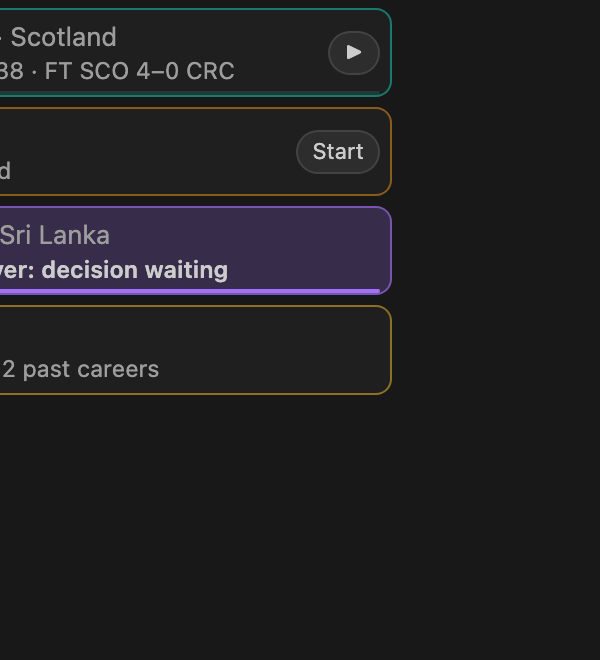
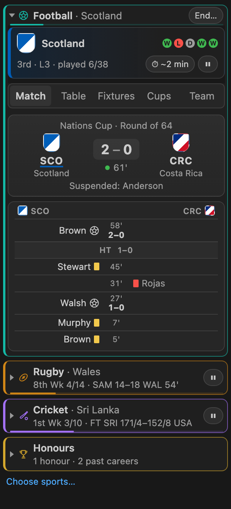
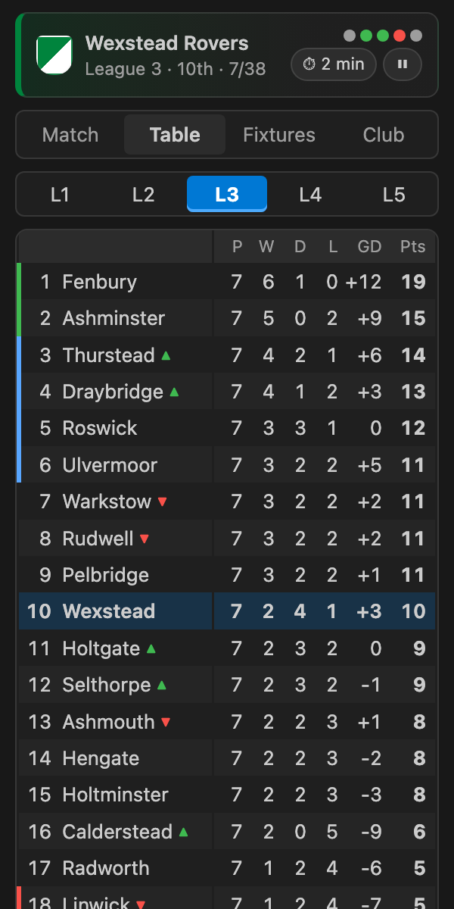
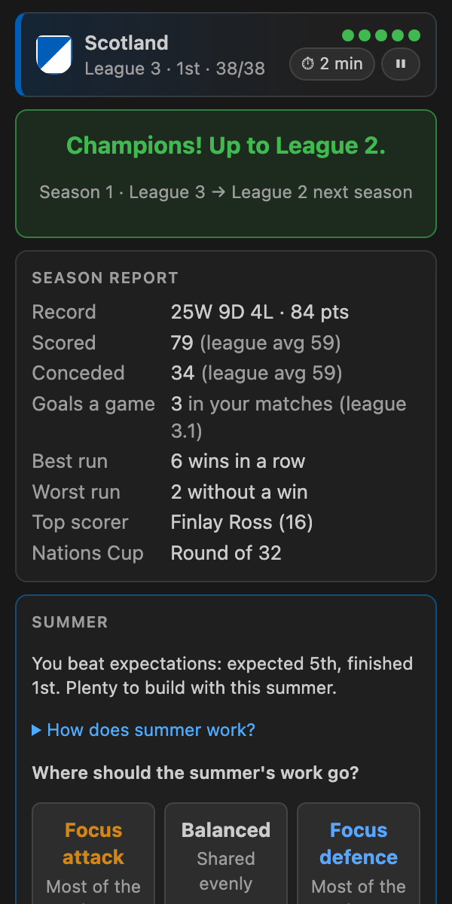
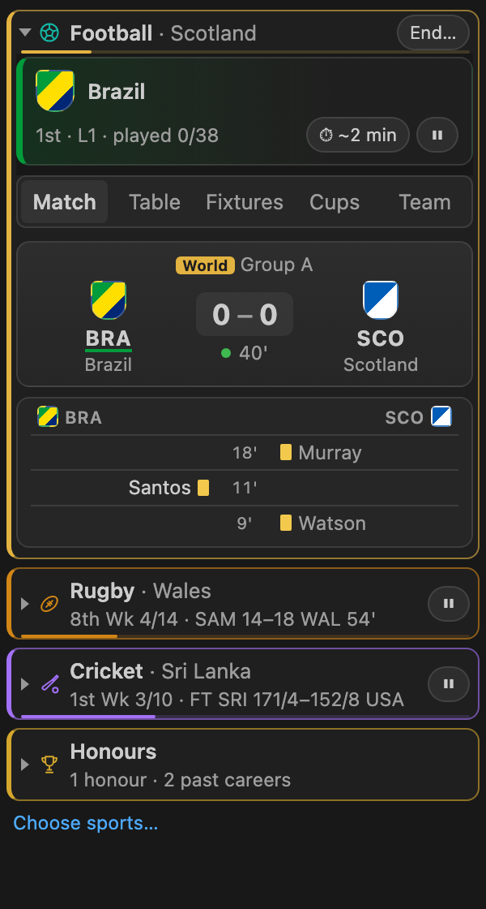
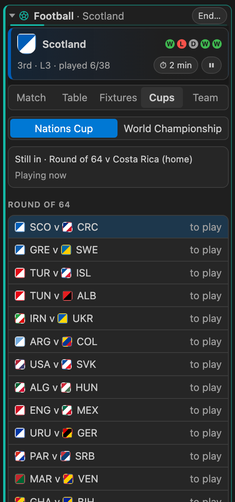

# Sports Simulator

International football, rugby and cricket sims that live in a small box in your VS Code sidebar. Pick a sport, your country and where it starts, and it plays every match, table, cup and season on its own while you code. Glance over when you like; once a season, you make one decision.

  
  
  
  
  
  

## How to play

1. **Start a career.** Open the Sports Simulator box in the Explorer. Pick a sport, your country, and the league it starts in (its usual level is marked; L1 is the top). Your team starts balanced; its character comes from the summers.
2. **Let it play.** Matches play live while VS Code is open. The table moves as goals go in. Pause any time with ⏸.
3. **Read the results.** You never see ratings. Every summer players retire or are dropped and your squad loses strength, more at one end of the pitch than the other. Where you ranked for goals scored and conceded, and who's leaving, are the clues. Let one side fall behind and it catches up with you over a season or two, and a fix takes a season or two to settle.
4. **Answer the summer question.** Call up a striker or a defender, appoint a coach, change formation or set the training camp: one answer strengthens the attack, the other the defence. Then press **Start next season**. Read it well and you climb; guess and you'll drift down. Finish above expectations and you have more to build with.
5. **Climb.** Finish high enough to go up and avoid the bottom places (see below). Win League 1 to be champions, then keep going: a great manager can build a side strong enough for an unbeaten season.
6. **Chase the cups.** Finish high enough to enter next season's Nations Cup. After every fourth season, Leagues 1 and 2 play the World Championship: its own mini season of groups and knockouts, after the summer's changes and before the next season.

## The sports

| | Football | Rugby | Cricket (T20) | Grand Prix |
|---|---|---|---|---|
| Nations | 100 in the world, about 210 to play as | 48 | 32 | 30 in the world, about 210 to play as |
| Leagues | 5 of 20 | 6 of 8 | 4 of 8 | GP1–GP3, 10 teams of two cars each |
| Up and down | Top 2 up, 3rd–6th play off, bottom 3 down | Top 2 up, bottom 2 down | Top 2 up, bottom 2 down | Top 2 up, bottom 2 down |
| Table | 3 for a win, 1 for a draw, goal difference | 4 for a win, 2 for a draw, bonus points for four tries and for losing by 7 or fewer, points difference | 2 for a win, net run rate; ties go to a super over | 25-18-15-12-10-8-6-4-2-1 per car, and a drivers' title |
| Nations Cup | Top 64 | Top 32 | Top 16 | None |
| World Championship | 40 teams, with a host | 16 teams, with a host | 12 teams, with a host | Race of Nations: one car each from GP1 and GP2 |
| Real match length (each plays at this against the others) | 110 min | 100 min | 190 min | 90 min |

**Speed.** One speed covers every sport, and each match keeps its real length against the others: at › a football match takes about 10 minutes, at ›› about 3 and at ››› about 1, with a rugby match a little shorter, a T20 nearly twice as long and a Grand Prix shorter still. A year with all four sports takes about 16 hours, 5 hours or 1¾ hours.

Play one sport or all four in one shared season. Only one match is on at a time: whichever sport is furthest behind in its season plays next, so they keep in step, and the summers come together at the end of the year. Each sport's World Championship falls in a different year. The box's main screen is the live match, whichever sport it's in, with one pause for everything; its full report folds away underneath. Below it is a tab for each sport, with a dot on the one playing, for its tables, fixtures, cups and team. Start a career from its tab; end or reset it from the foot of its Team tab. Each career keeps its own match length.

Only want one? Press **Choose sports…** under the list and untick the rest; a hidden career waits where it was until you tick it again.

The **Honours** row keeps what lasts: your greatest teams and all-time records, past careers, and honours for doing well in more than one sport.

To stop a career, press **End…** on its row. **End career** keeps it in Past careers; **Reset career** deletes it as if it was never played. **Reset honours**, at the bottom of the Honours page, deletes your honours and past careers. Both resets ask again in red, because they can't be undone.

## Features

- Four sports, with promotion and relegation in each; big nations start near the top, shuffled a little every career
- Play several sports at once, listed in the box with one open at a time
- Honours, greatest teams and all-time records across every career
- The Nations Cup every season, and the World Championship as its own mini season every four, each with its own Cups tab (draws, groups, results and past winners)
- Badges show at a glance when a match is a cup tie, a play-off or the World Championship
- Live match reports with each team's events on its own side, a real scorecard in cricket, and live tables, with your score, week and league place in the status bar (and a *GOAL!*, *TRY!* or *WICKET!* as it happens); with several careers it shows each sport's week and place in turn; hover it for your position and expected finish
- Collapse the box and its title still shows your position and score
- A soft colour fade in the box, on the open sport and on minimised rows: green when it goes your way, red when it doesn't
- Works by keyboard, with screen reader announcements and high contrast themes
- Fits any size: shrink the box and it keeps just the essentials (club, league, position, form and controls)
- Season reports, trophy cabinet, club history and records
- Pauses when VS Code closes, and stops after 5 minutes without a click or key press, so you never miss a match
- With several VS Code windows open, the game runs in the one you're working in, and moves to another when that one closes

Player names are generated and fictional. Competitions are the game's own, not official tournaments.

## Settings

| Setting | Default | What it does |
|---|---|---|
| `sportsSimulator.sports` | all on | The sports to show, also set from **Choose sports…** in the box. Hiding one with a career under way stops its clock and keeps the career, which carries on from the same moment when you show it again. |
| `sportsSimulator.showHonours` | `true` | Show the Honours row and a notification for each honour earned. Honours and records still count while it's off. |
| `sportsSimulator.speed` | `normal` | How fast every sport plays: `normal` (›, a football match in about 10 minutes), `fast` (››, about 3) or `fastest` (›››, about 1). Also set from the › button beside the pause. |
| `sportsSimulator.fullTimeOverlay` | `true` | Show the full-time result over the box for a few seconds after your match. |
| `sportsSimulator.statusBarScore` | `true` | Show your live score in the status bar. With several careers it shows each sport's week and league place in turn instead, for 5 seconds each. Click it to open the box at the sport on show. |

Commands: **Sports Simulator: Open**, **Pause / Play**, **Switch Sport** and **Choose Sports**.

## Feedback

Found a bug or have an idea? [Open an issue](https://github.com/BigMoneyGreg/sports-simulator/issues).

## Privacy

Sports Simulator collects nothing and never connects to the internet. Your careers stay on your own machine.

## Licence

[MIT](LICENSE)
