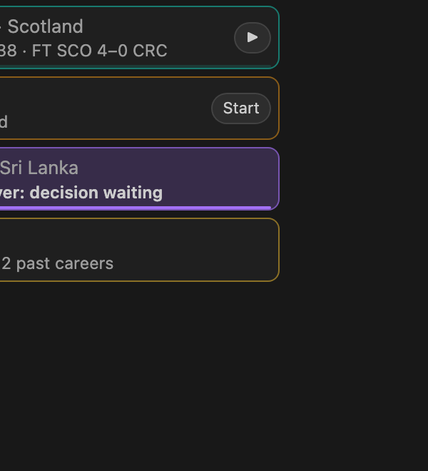
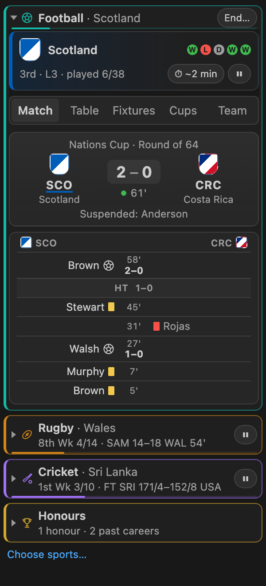
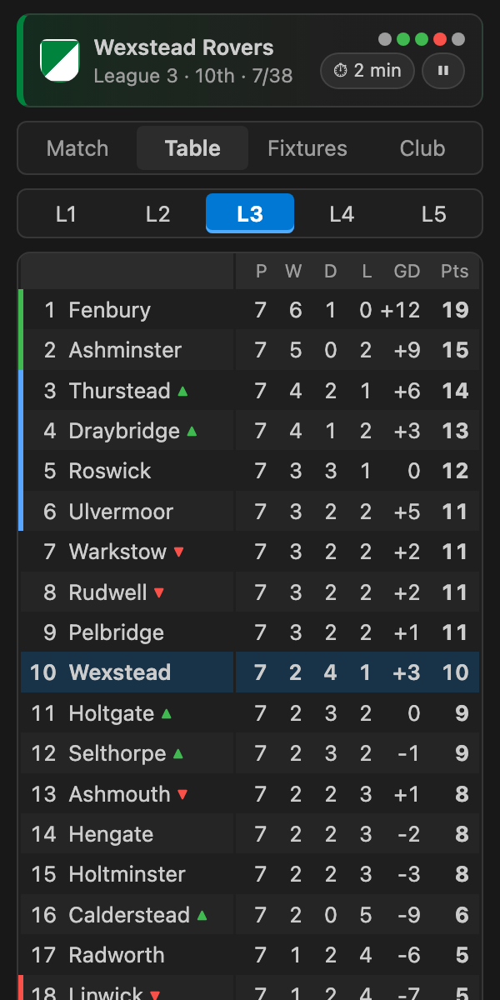
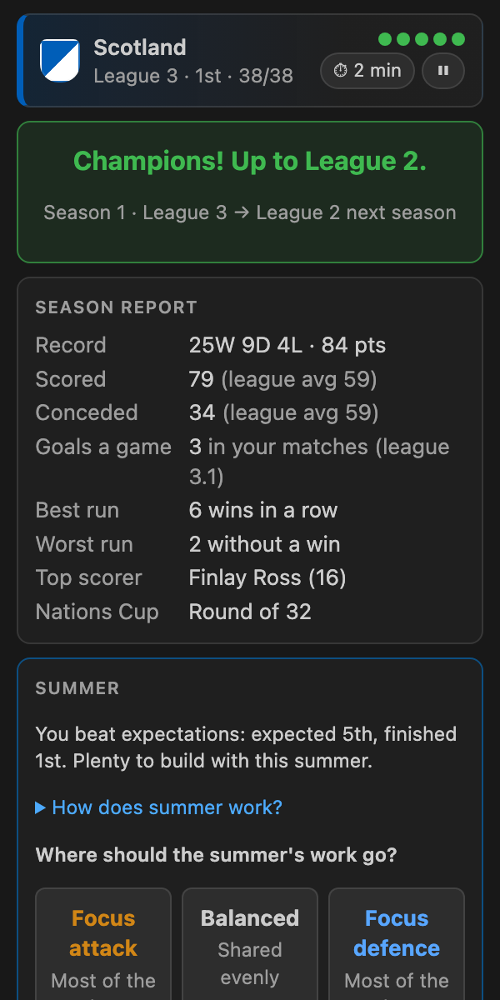
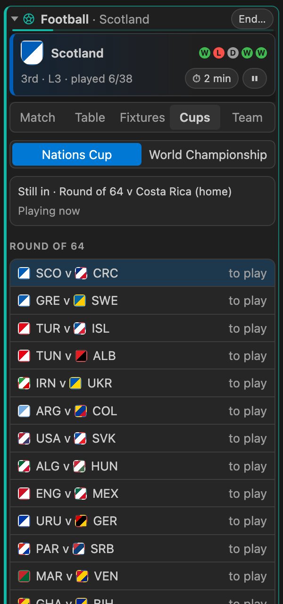

# Sports Simulator

International football, rugby and cricket sims that live in a small box in your VS Code sidebar. Pick a sport, your country and where it starts, and it plays every match, table, cup and season on its own while you code. Glance over when you like; once a season, you make one decision.

  
  
  
  
  

## How to play

1. **Start a career.** Open the Sports Simulator box in the Explorer. Pick a sport, your country, the league it starts in (its usual level is marked; L1 is the top) and a match length. Your team starts balanced; its character comes from the summers.
2. **Let it play.** Matches play live while VS Code is open. The table moves as goals go in. Pause any time with ⏸.
3. **Read the results.** You never see ratings. Every summer players retire or are dropped and your squad loses strength, more at one end of the pitch than the other. Where you ranked for goals scored and conceded, and who's leaving, are the clues. Let one side fall behind and it catches up with you over a season or two, and a fix takes a season or two to settle.
4. **Answer the summer question.** Call up a striker or a defender, appoint a coach, change formation or set the training camp: one answer strengthens the attack, the other the defence. Then press **Start next season**. Read it well and you climb; guess and you'll drift down. Finish above expectations and you have more to build with.
5. **Climb.** Finish high enough to go up and avoid the bottom places (see below). Win League 1 to be champions, then keep going: a great manager can build a side strong enough for an unbeaten season.
6. **Chase the cups.** Finish high enough to enter next season's Nations Cup. After every fourth season, Leagues 1 and 2 play the World Championship: its own mini season of groups and knockouts, after the summer's changes and before the next season.

## The sports

| | Football | Rugby | Cricket (T20) |
|---|---|---|---|
| Nations | 100 in the world, about 210 to play as | 48 | 30 |
| Leagues | 5 of 20 | 6 of 8 | 5 of 6 |
| Up and down | Top 2 up, 3rd–6th play off, bottom 3 down | Top 2 up, bottom 2 down | Top 1 up, bottom 1 down |
| Table | 3 for a win, 1 for a draw, goal difference | 4 for a win, 2 for a draw, bonus points for four tries and for losing by 7 or fewer, points difference | 2 for a win, net run rate; ties go to a super over |
| Nations Cup | Top 64 | Top 32 | Top 16 |
| World Championship | 40 teams | 16 teams | 12 teams |
| Match lengths | ~30 sec, ~2 min, ~5 min, ~10 min | ~1½ min, ~5 min, ~15 min, ~30 min | ~2 min, ~10 min, ~20 min, ~40 min |
| Season at those lengths | ~25 min, ~1½ hr, ~3¾ hr, ~7½ hr | ~25 min, ~1½ hr, ~4 hr, ~8 hr | ~20 min, ~1¾ hr, ~3½ hr, ~7 hr |

Play one sport or all three at once. The box lists them: start or end each one whenever you like, and open one to see it in full while the others show one line and carry on. Pause any of them from its row. Each career keeps its own match length.

Only want one? Press **Choose sports…** under the list and untick the rest; a hidden career waits where it was until you tick it again.

The **Honours** row keeps what lasts: your greatest teams and all-time records, past careers, and honours for doing well in more than one sport.

To stop a career, press **End…** on its row. **End career** keeps it in Past careers; **Reset career** deletes it as if it was never played. **Reset honours**, at the bottom of the Honours page, deletes your honours and past careers. Both resets ask again in red, because they can't be undone.

## Features

- Three sports, with promotion and relegation in each; big nations start near the top, shuffled a little every career
- Play several sports at once, listed in the box with one open at a time
- Honours, greatest teams and all-time records across every career
- The Nations Cup every season, and the World Championship as its own mini season every four, each with its own Cups tab (draws, groups, results and past winners)
- Badges show at a glance when a match is a cup tie, a play-off or the World Championship
- Live match reports with each team's events on its own side, a real scorecard in cricket, and live tables, with your score, week and league place in the status bar (and a *GOAL!*, *TRY!* or *WICKET!* as it happens); with several careers it shows each sport's week and place in turn; hover it for your position and expected finish
- Collapse the box and its title still shows your position and score
- A flash in the box: green when it goes your way, red when it doesn't
- Works by keyboard, with screen reader announcements and high contrast themes
- Fits any size: shrink the box and it keeps just the essentials (club, league, position, form and controls)
- Season reports, trophy cabinet, club history and records
- Pauses when VS Code closes, so you never miss a match
- With several VS Code windows open, the game runs in the one you're working in, and moves to another when that one closes

Player names are generated and fictional. Competitions are the game's own, not official tournaments.

## Settings

| Setting | Default | What it does |
|---|---|---|
| `sportsSimulator.sports` | all on | The sports to show, also set from **Choose sports…** in the box. Hiding one with a career under way stops its clock and keeps the career, which carries on from the same moment when you show it again. |
| `sportsSimulator.showHonours` | `true` | Show the Honours row and a notification for each honour earned. Honours and records still count while it's off. |
| `sportsSimulator.matchDuration` | `30s` | Real time one match takes in a new career (see the table above); a career under way keeps its own, set from the ⏱ button. If your sport doesn't offer this length, the next longer one is used, so the default gives a season of about 20 to 25 minutes in every sport. Starting a career at another length makes that the default until you change this setting. |
| `sportsSimulator.fullTimeOverlay` | `true` | Show the full-time result over the box for a few seconds after your match. |
| `sportsSimulator.statusBarScore` | `true` | Show your live score in the status bar. With several careers it shows each sport's week and league place in turn instead, for 5 seconds each. Click it to open the box at the sport on show. |

Commands: **Sports Simulator: Open**, **Pause / Play**, **Switch Sport** and **Choose Sports**.

## Feedback

Found a bug or have an idea? [Open an issue](https://github.com/BigMoneyGreg/sports-simulator/issues).

## Privacy

Sports Simulator collects nothing and never connects to the internet. Your careers stay on your own machine.

## Licence

[MIT](LICENSE)
